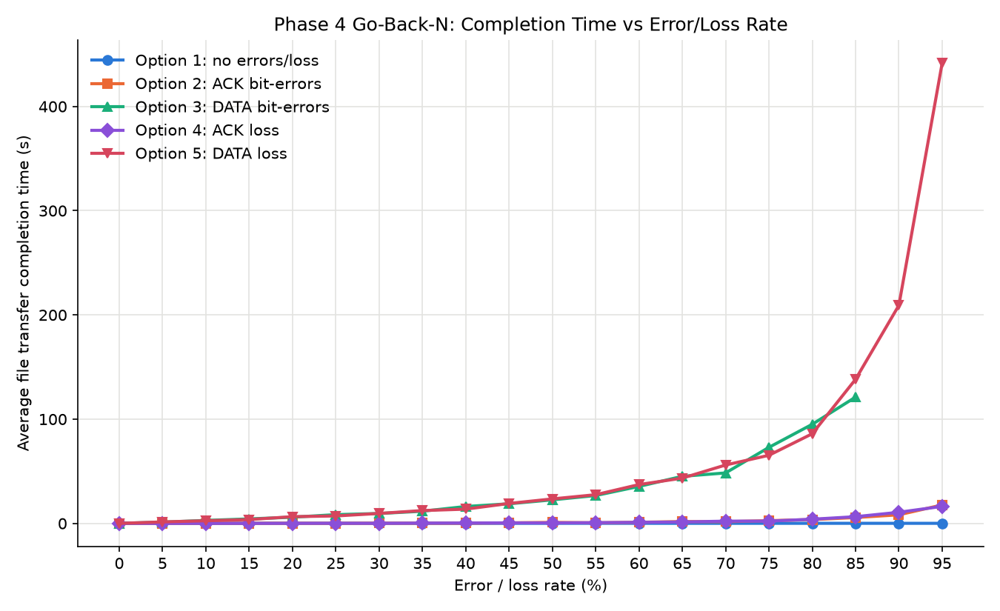

# Network Design Project: Phase 2 (RDT 2.2)
Maroua Boumkouk, Matthew Nguyen, Oluchukwu Okeke 

## Overview
Phase 2 adds RDT 2.2 on top of the Phase 1 UDP file transfer. It uses a checksum, alternating 0/1 sequence numbers, and ACKs only (no NAKs), with stop-and-wait sending. It covers three options: no errors, ACK bit-errors, and DATA bit-errors.

## Team
| Name | Email | Primary responsibility |
|---|---|---|
| Maroua Boumkouk | Maroua_Boumkouk@student.uml.edu | `packet.py` (header + checksum), `corruption.py` (bit flips), design document, final check of all deliverables also experiments and plot (`run_experiments.py`, `plot_results.py`) |
| Matthew Nguyen | Matthew_Nguyen@student.uml.edu | `sender.py` (sender FSM, Option 2), README, demo video |
| Oluchi Okeke | Oluchi_Okeke@student.uml.edu | `receiver.py` (receiver FSM, Option 3)|

## Demo Video
- **YouTube (unlisted):** https://youtu.be/wzna6eNO37I

---

## Repository Structure
```
src/       packet.py (header + checksum), corruption.py (bit flips), sender.py, receiver.py
scripts/   test_rdt.py, run_experiments.py, plot_results.py
docs/      DESIGN_DOCUMENT.md
results/   raw_times.csv, avg_times.csv, completion_time.png
data/      small.bmp (390 KB test image)
README.md
```

## Requirements
- Python 3.12+ (tested on 3.12 macOS and 3.13 Linux)
- Transfer code: standard library only (`socket`, `struct`, `argparse`)
- Plot only: `pip install matplotlib`

---

## CLI
Both programs take the same flags:

| Flag | Meaning | Default |
|---|---|---|
| `--option` | 1 = no errors, 2 = ACK bit-errors, 3 = DATA bit-errors | 1 |
| `--error-rate` | chance (0–1) a packet gets one bit flipped | 0 |
| `--port` | receiver port | 9000 |
| `--quiet` | turn off printing | off |
| `--file` (sender) | file to send | `../data/small.bmp` |
| `--out` (receiver) | where to write it | `../results/received.bmp` |

Use the **same** `--option` and `--error-rate` on both sides. Option 2 flips bits at the sender (in ACKs), and Option 3 flips bits at the receiver (in DATA).

---

## Running the three options
Run everything from inside `src/`. Start the receiver first, then run the sender in a second terminal.

### Option 1: no errors
```bash
python receiver.py --option 1
python sender.py --option 1
```
Expected: every packet ACKed once, 0 resends.

### Option 2: ACK bit-errors (example 20%)
```bash
python receiver.py --option 2 --error-rate 0.2
python sender.py --option 2 --error-rate 0.2
```
Expected: sender prints `corrupt ACK -> resend`, receiver prints `duplicate ... -> resend last ACK`.

### Option 3: DATA bit-errors (example 20%)
```bash
python receiver.py --option 3 --error-rate 0.2
python sender.py --option 3 --error-rate 0.2
```
Expected: receiver prints `corrupt packet -> resend last ACK`, sender prints `ACK x but waiting for ACK y -> resend`.

### Check the file
```bash
cmp ../data/small.bmp ../results/received.bmp && echo SAME
```
You can also just open `results/received.bmp`.

---

## Tests
From the repo root:
```bash
python scripts/test_rdt.py
```
This checks the packet round trip, checks that every single-bit flip is caught by the checksum, and runs Option 1 at 0% and Options 2 and 3 at 30% and 90%, comparing SHA-256 each time.

## Reproducing the plot
From the repo root:
```bash
python scripts/run_experiments.py      # about 2-3 min; 3 options x 20 rates x 5 runs
python scripts/plot_results.py
```
- Printing is off during timing.
- Every run is checked with SHA-256.
- Output: `results/raw_times.csv`, `results/avg_times.csv`, `results/completion_time.png`.

## Results


- **Option 1** stays flat (about 0.11 s), since there are no errors.
- **Options 2 and 3** follow about 1/(1−p): small change up to ~30%, then fast growth. 95% takes about 13× longer than 0% (1.5 s vs 0.11 s).
- Options 2 and 3 cost about the same, because either way one bad packet costs one extra DATA + ACK round trip.

---

## Known Issues / Limitations
- RDT 2.2 assumes no packet loss, so there is no timer. If a packet were really lost, the sender would wait. There is a 10 s safety timeout that stops the program with an error; it does not retransmit (that comes in RDT 3.0).
- We changed the textbook `oncethru` rule: the receiver always resends its last ACK (starting as ACK 1) so a corrupt first packet can't deadlock. See the design doc, section 3.1.
- The receiver stays open 2 s after END in case its last ACK got corrupted.

## Academic Integrity / External Tools
Debugging tools and LLMs may be used for learning and troubleshooting. Final implementation decisions and understanding are our own.
