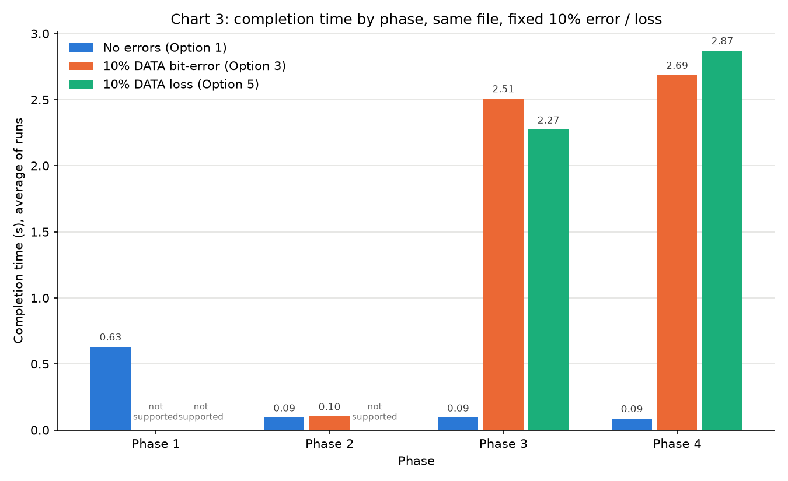

# Network Design Project: Phase 4 (Go-Back-N over UDP)
Maroua Boumkouk, Matthew Nguyen, Oluchukwu Okeke 

## Overview
Phase 4 replaces our Phase 3 stop-and-wait (RDT 3.0) with Go-Back-N (GBN). The sender can now have up to N packets in flight at once instead of 1. Sequence numbers count up (1, 2, 3, ...) instead of 0/1, ACKs are cumulative, and on a timeout the sender resends every unACKed packet in the window. The receiver only accepts the next in-order packet and drops everything else. It covers the same five options: no errors, ACK bit-errors, DATA bit-errors, ACK loss, and DATA loss. Each option can also be run with recovery turned off.

## Team
| Name | Email | Primary responsibility |
|---|---|---|
| Maroua Boumkouk | Maroua_Boumkouk@student.uml.edu | Design document, `packet.py` (4-byte ACK field, checksum fix), `--no-recovery` flag, tests (`test_rdt.py`), README, final check of all deliverables |
| Matthew Nguyen | Matthew_Nguyen@student.uml.edu | `sender.py` (GBN window, buffer, timer, go-back-N resend), testing all options, experiments and plots (`run_experiments.py`, `plot_results.py`) |
| Oluchi Okeke | Oluchi_Okeke@student.uml.edu | `receiver.py` (GBN receiver, cumulative ACKs), Phase 1 and 2 code for Chart 3, demo video |
## Demo Video
- **YouTube (unlisted):** https://youtu.be/Zv0cYDouGZs

---

## Repository Structure
```
src/       packet.py (header + checksum), corruption.py (bit flips + drops), sender.py, receiver.py
scripts/   test_rdt.py, run_experiments.py, plot_results.py
phases/    Phase 1 and Phase 2 code (for Chart 3)
docs/      DESIGN_DOCUMENT.md
results/   raw_times.csv, avg_times.csv, chart1_options.png, chart2_window.png, chart3_phases.png
data/      small.bmp (390 KB test image), tiny.bmp (small copy, for timing experiments)
README.md
```

## Requirements
- Python 3.12+ (tested on 3.12 macOS and 3.13 Linux)
- Transfer code: standard library only (`socket`, `struct`, `argparse` , `time`, `random`)
- Plot only: `pip install matplotlib`

---


## What's new in Phase 3
- **Sliding window (sender):** the sender sends up to N packets before waiting for ACKs. It keeps all packets in a buffer and tracks `base` (oldest unACKed) and `nextseqnum` (next to send). Default N = 10.
- **Counting sequence numbers:** packets are numbered 1, 2, 3, ... instead of 0/1.
- **Cumulative ACKs:** ACK n means every packet up to n arrived, so the window slides to `base = n + 1`. One ACK can cover a lost or corrupted ACK before it.
- **One timer, Go-Back-N resend:** the timer is for the oldest unACKed packet. On timeout, the sender resends every packet from `base` to `nextseqnum - 1`. Timeout: 50 ms.
- **GBN receiver:** keeps `expectedseqnum`. It only writes the packet it expects next. Corrupt, out-of-order, or duplicate packets are dropped and the last ACK is resent. No buffering.
- **Packet format change:** the ACK field is now 4 bytes (was 1 byte), so cumulative ACKs work past 255. Header is now 13 bytes (was 10). Because of the odd header size, `is_corrupt()` now recomputes the checksum and compares, instead of checking that the sum is 0.
- **Recovery ON/OFF:** `--no-recovery` turns off the timer, resends, and checks so we can show what happens without GBN.
- Kept from Phase 3: `maybe_corrupt()` / `maybe_drop()`, END retry cap (50), receiver idle timeout (10 s), receiver linger after END.

## CLI
Both programs take the same flags (except where noted):
 
| Flag | Meaning | Default |
|---|---|---|
| `--option` | 1 = no errors, 2 = ACK bit-errors, 3 = DATA bit-errors, 4 = ACK loss, 5 = DATA loss | 1 |
| `--error-rate` | chance (0–1) a packet is corrupted (Options 2, 3) or dropped (Options 4, 5) | 0 |
| `--window` (sender) | window size N | 10 |
| `--timeout` (sender) | timer length in seconds | 0.05 |
| `--no-recovery` | turn off GBN recovery (no timer, no resends, no checks) | off |
| `--port` | receiver port | 9000 |
| `--quiet` | turn off printing | off |
| `--file` (sender) | file to send | `../data/small.bmp` |
| `--out` (receiver) | where to write it | `../results/received.bmp` |
 
Use the **same** `--option`, `--error-rate`, and `--no-recovery` on both sides. Options 2 and 4 act at the sender (on ACKs). Options 3 and 5 act at the receiver (on DATA).
 
---
## Running the five options
Run everything from inside `src/`. Start the receiver first, then run the sender in a second terminal.

### Option 1: no errors
```bash
python receiver.py --option 1
python sender.py --option 1
```
Expected: every packet ACKed once, 0 resends.

### Option 2: ACK bit-errors (example 20%)
```bash
python receiver.py --option 2 --error-rate 0.2
python sender.py --option 2 --error-rate 0.2
```
Expected: sender prints \corrupt ACK -> keep waiting`, times out, and resends. Receiver prints `duplicate ... -> resend last ACK`.`

### Option 3: DATA bit-errors (example 20%)
```bash
python receiver.py --option 3 --error-rate 0.2
python sender.py --option 3 --error-rate 0.2
```
Expected: receiver finds the corrupt packet and resends its last ACK. Sender sees the wrong ACK, ignores it, times out, and resends. 
### Option 4: ACK loss (example 20%)
```bash
python receiver.py --option 4 --error-rate 0.2
python sender.py --option 4 --error-rate 0.2
```
Expected: sender drops the ACK, times out, and resends. Receiver sees a duplicate and resends its last ACK.
 
### Option 5: DATA loss (example 20%)
```bash
python receiver.py --option 5 --error-rate 0.2
python sender.py --option 5 --error-rate 0.2
```
Expected: receiver drops the packet and sends nothing. Sender times out and resends.

### Recovery ON vs OFF
```bash
# Recovery OFF: image comes out broken
python receiver.py --option 5 --error-rate 0.2 --no-recovery
python sender.py --option 5 --error-rate 0.2 --no-recovery
 
# Recovery ON (default): image comes out the same as the original
python receiver.py --option 5 --error-rate 0.2
python sender.py --option 5 --error-rate 0.2
```
Use Option 3 or 5 to show this. With recovery OFF the sender ignores ACKs, so Options 2 and 4 (which only hit ACKs) still give a correct file.

### Check the file
```bash
cmp ../data/small.bmp ../results/received.bmp && echo SAME
```
You can also just open `results/received.bmp`.

---

## Tests
From the repo root:
```bash
python scripts/test_rdt.py
```
Checks the packet format (seq/ACK above 255, every single-bit flip caught), `maybe_drop()`, runs Option 1 at 0% and Options 2–5 at 30% and 50%, runs window sizes 1, 2, 5, 10, 20, 50, and compares SHA-256 each time. Also checks that recovery OFF gives a different file at 30%.
 

## Reproducing the plot
From the repo root:
```bash
python scripts/run_experiments.py --file data/tiny.bmp
python scripts/plot_results.py
```
- We use `tiny.bmp` so all runs finish in a reasonable time.
- Each point is the average of 5 runs.
- Printing is off during timing.
- Every run is checked with SHA-256.
| Chart | x-axis | Settings | Output |
|---|---|---|---|
| 1 | Error/loss rate 0%–95% (step 5%) | All 5 options, N = 10 | `results/chart1_options.png` |
| 2 | Window size 1, 2, 5, 10, 20, 50 | Option 5, 10% loss | `results/chart2_window.png` |
| 3 | Phase 1, 2, 3, 4 | Same file, 10% loss and 10% bit-error | `results/chart3_phases.png` |
 
Raw times: `results/raw_times.csv`. Averages: `results/avg_times.csv`.
 
## Results


File: `data/tiny.bmp`, timeout 50 ms, each point = average of 5 runs.

| Rate | Opt 1 | Opt 2 | Opt 3 | Opt 4 | Opt 5 |
|---|---|---|---|---|---|
| 0% / 30% | 0.009 s | 0.56 s | 0.81 s | 0.66 s | 0.66 s |
| 50% | 0.010 s | 1.28 s | 1.44 s | 1.36 s | 1.74 s |
| 80% | 0.009 s | 5.92 s | 6.65 s | 5.45 s | 5.51 s |
| 95% | 0.009 s | 29.54 s | 24.58 s | 27.67 s | 27.61 s |

- **Option 1** stays flat (about 0.01 s), since nothing goes wrong.
- **Options 2-5 all grow like p/(1-p):** slow at first, then very fast after about 70%. At 95%, each packet needs about 20 tries on average, so the transfer is about 3000x slower than Option 1.
- **All four error/loss options cost about the same.** In RDT 3.0 the sender ignores bad or wrong ACKs and waits for the timeout, so a corrupted packet and a lost packet both cost one 50 ms timeout. The timeout is much bigger than the round trip on localhost, so it is what sets the time.
- The small differences between Options 2-5 (for example at 95%) come from randomness. With only 5 runs per point, a few unlucky retries change the average a lot.
### Chart 1: completion time vs. error/loss rate

 
TODO: table + what we see
 
### Chart 2: completion time vs. window size (10% loss)

 
TODO: best window size
 
### Chart 3: Phase 1 vs. 2 vs. 3 vs. 4

 
TODO
 
### Optimal window size and timeout
TODO
 
---

## Known Issues / Limitations
- The receiver does not buffer out-of-order packets (that is how GBN works), so one lost packet makes the sender resend the whole window. Selective Repeat fixes this.
- The timeout is fixed (50 ms), not adaptive like TCP. It is tuned for localhost.
- Phase 2 (RDT 2.2) has no timer, so it can't finish with packet loss. In Chart 3 it is only timed with bit-errors.
- The receiver stays open for a short time after END in case its last ACK is lost or corrupted. The sender caps END retries so it can still finish.

## Academic Integrity / External Tools
Debugging tools and LLMs may be used for learning and troubleshooting. Final implementation decisions and understanding are our own.
