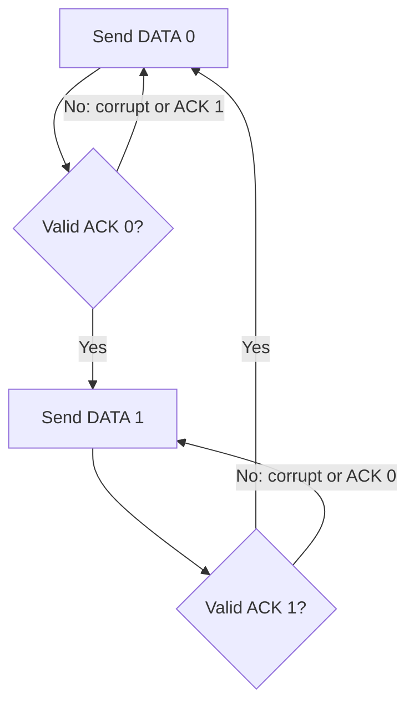
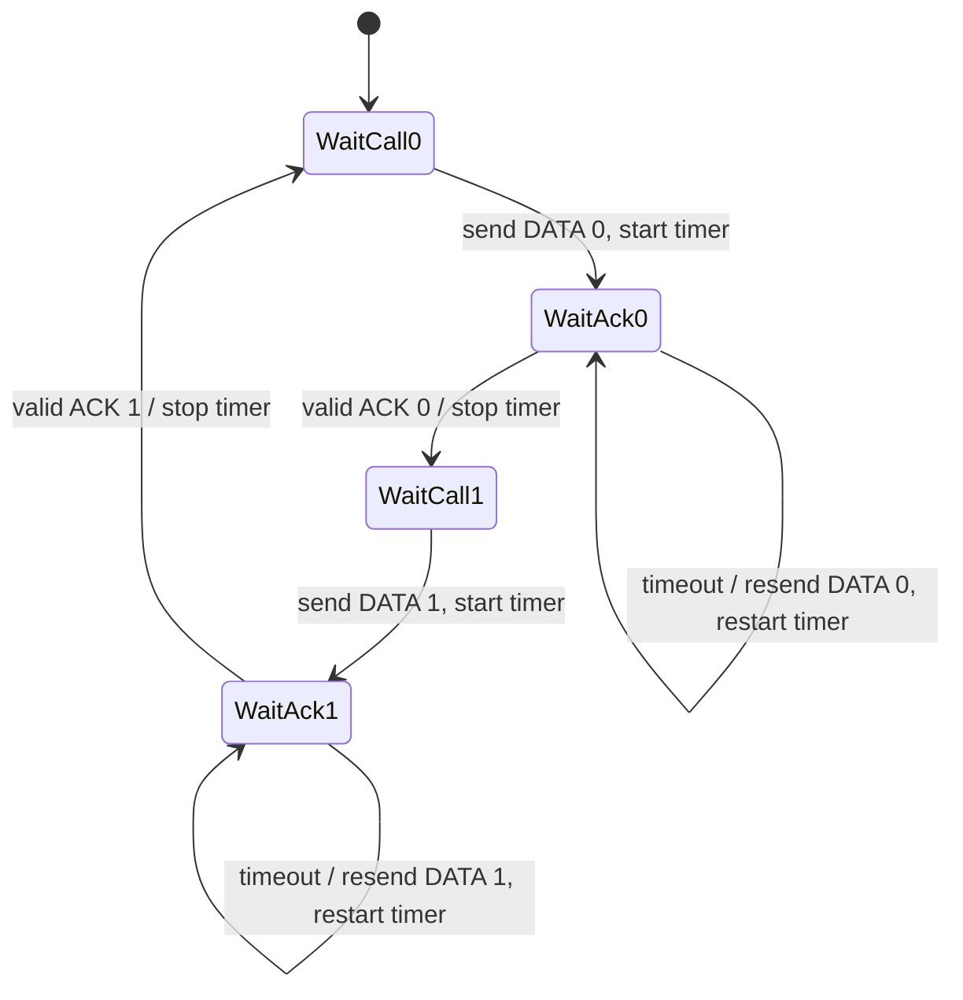
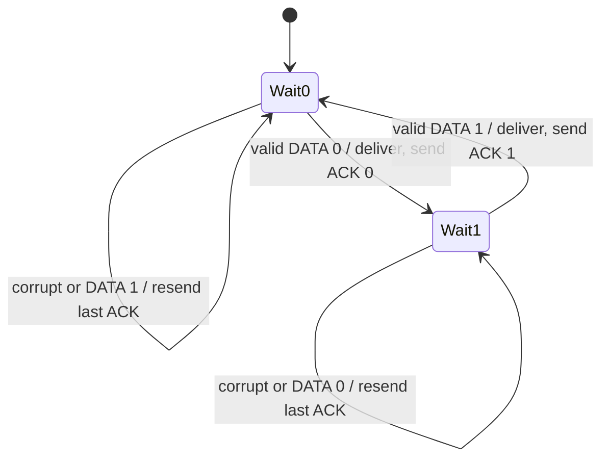

## Network Design Project - Phase Proposal and Design Document (Phase 3 of 5)
**Purpose:** Phase 3 adds RDT 3.0 to our UDP file transfer. The sender gets a countdown timer so it can recover from lost DATA and ACK packets, not just corrupted ones.  
**Names:** Maroua Boumkouk, Matthew Nguyen, Oluchukwu Okeke   
**GitHub Repo URL (with GitHub usernames):** https://github.com/MarouaBoumkouk/Network-Design-Phase-3  
**Phase:** 3 
**Submission Date:** Saturday 24 October 2026  
**Version:** (1)

## 0) Executive Summary 
   In Phase 2 we built RDT 2.2 (checksum, alternating 0/1 sequence numbers, ACK-only, stop-and-wait). RDT 2.2 assumes packets are never lost, so if a packet disappears the sender waits forever. In Phase 3 we add a countdown timer to the sender (RDT 3.0). If no valid ACK arrives before the timer runs out, the sender resends the same packet. The receiver stays the same as RDT 2.2.

We will test five scenarios:
1. No errors or loss
2. ACK bit-errors at the sender
3. DATA bit-errors at the receiver
4. ACK loss at the sender
5. DATA loss at the receiver

## 1) Phase requirements
### 1.1 Demo deliverable
- **Private YouTube link:** https://youtu.be/Zv0cYDouGZs


### 1.2 Required demo scenarios
| Option | Scenario | Where it happens | Expected result |
|---|---|---|---|
| 1 | No errors/loss | - | File transfers with 0 resends |
| 2 | ACK bit-error | Sender, after receiving an ACK | Sender ignores the corrupt ACK, times out, resends |
| 3 | DATA bit-error | Receiver, after receiving DATA | Receiver resends last ACK; sender ignores the wrong ACK, times out, resends |
| 4 | ACK loss | Sender, after receiving an ACK | ACK is dropped; sender times out and resends |
| 5 | DATA loss | Receiver, after receiving DATA | DATA is dropped, no ACK sent; sender times out and resends |
 
For every option we check that the original and received files have the same SHA-256 hash.

### 1.3 Required figures / plots

- One chart with 5 lines (Options 1-5)
- x-axis: error/loss rate, 0% to 95% in steps of 5%
- y-axis: average completion time (seconds)
- Each point is the average of 5 runs
  

## 2) Phase plan 


### 2.1 Scope: what changes/additions this phase

- Countdown timer in the sender (start, stop, timeout)
- Resend on timeout and restart the timer
- Corrupt or wrong ACKs are ignored (sender waits for the timeout), to match the RDT 3.0 FSM
- Packet loss injection: `maybe_drop()` for Options 4 and 5
- Cap on END retries so the sender can't loop forever after the receiver closes
- Experiments and plot for all 5 options
**Not changing:**
- Packet format and checksum (`packet.py`)
- Receiver logic (RDT 3.0 receiver = RDT 2.2 receiver)
**Out of scope:**
- Pipelining (Go-Back-N, Selective Repeat) - later phases
- Adaptive timeout (like TCP's RTT estimate)
- Sending multiple files at once
     
### 2.2 Acceptance criteria 

- [ ] File transfers correctly in all 5 options (SHA-256 match)
- [ ] Sender resends when the timer runs out
- [ ] Sender stops the timer on a valid ACK
- [ ] Corrupt/wrong ACKs do not cause an instant resend
- [ ] Lost ACKs (Option 4) and lost DATA (Option 5) are recovered
- [ ] Receiver ignores duplicates and resends its last ACK
- [ ] Plot has 5 lines, 0-95% in steps of 5%, each point = average of 5 runs

### 2.3 Work breakdown 

**Workstream A - Design, loss injection, tests, README** (Maroua Boumkouk)
Design document, `maybe_drop()` in `corruption.py`, `test_rdt.py` for all 5 options, README, final check.
 
**Workstream B - Sender** (Matthew Nguyen)
Countdown timer, ignore bad ACKs, Option 4 ACK drop, END retry cap, demo video.
 
**Workstream C - Receiver and experiments** (Oluchukwu Okeke)
Option 5 DATA drop, `run_experiments.py` and `plot_results.py` for 5 options.
 


## 3) Architecture + state diagrams

## 3.1 How we Evolved the state diagram
In Phase 2 the sender only resent when it got a corrupt or wrong ACK. If a packet was lost, nothing came back and the sender was stuck. In Phase 3 the timer fixes this: every send starts the timer, and a timeout means "resend". We also changed the sender so a corrupt or wrong ACK does nothing (the timer handles it), which is what the RDT 3.0 FSM says.
 
**Previous phase (Phase 2 - RDT 2.2 sender):**

 
**Current phase (Phase 3 - RDT 3.0 sender):**

 
**Receiver (same as RDT 2.2):**

 
### 3.2 Component responsibilities
- **Sender (`sender.py`)**
  - Splits the file into 1024-byte chunks and sends them one at a time
  - Runs the countdown timer and resends on timeout
  - Checks ACKs (checksum, type, ACK number)
  - Option 2: corrupts received ACKs; Option 4: drops received ACKs
  - Measures completion time
- **Receiver (`receiver.py`)**
  - Checks DATA packets (checksum, sequence number)
  - Writes in-order data, ignores duplicates, resends last ACK
  - Option 3: corrupts received DATA; Option 5: drops received DATA
  - Stays open for a short time after END in case its last ACK is lost
- **Shared modules**
  - Packet encode/decode + checksum: `packet.py`
  - Bit errors + loss: `corruption.py` (`maybe_corrupt()`, `maybe_drop()`)
  - Timing: `time.perf_counter()`
  - CLI: `argparse`


### 3.3 Message flow overview

The sender sends one DATA packet and starts the timer. The receiver answers with an ACK. If the ACK is valid, the sender stops the timer and sends the next packet. If the DATA or ACK is lost or corrupted, no valid ACK arrives, the timer runs out, and the sender resends.

## 4) Packet format 
Same as Phase 2 (no changes).

### 4.1 Packet types
| Type | Value | Description |
|---|---|---|
| DATA | 0 | File data |
| END | 1 | End of transfer |
| ACK | 2 | Acknowledgment |

### 4.2 Header fields 

| Field | Size | Description |
|---|---|---|
| Type | 1 byte | DATA, END, or ACK |
| Sequence Number | 4 bytes | 0 or 1 |
| ACK Number | 1 byte | Seq number being ACKed |
| Length | 2 bytes | Payload length |
| Checksum | 2 bytes | 16-bit Internet checksum over header + payload |
| Payload | Up to 1024 bytes | File data |
 
**Header format:** `>BIBHH` | **Header size:** 10 bytes
**Header Size:** 10 bytes

## 5) Data structures + module map

### 5.1 Key data structures
| Structure | Purpose | Module |
|---|---|---|
| `seq` (0/1) | Current sequence number | `sender.py`, `receiver.py` |
| `sndpkt` | Last packet sent, kept for resends | `sender.py`, `receiver.py` |
| `deadline` | Time when the timer runs out | `sender.py` |
| `RDT_TIMEOUT`| Timer length (about 50 ms) | `sender.py` |
| `MAX_END_RETRIES` | Cap on END resends | `sender.py` |
| `times[option][rate][run]` | Raw completion times | `run_experiments.py` | 
   


### 5.2 Module map + dependencies
| Module | Responsibility |
|---|---|
| `src/sender.py` | Sending, timer, ACK checks, resends, Options 2 and 4 |
| `src/receiver.py` | Receiving, duplicate check, ACKs, Options 3 and 5 |
| `src/packet.py` | Packet format and checksum |
| `src/corruption.py` | `maybe_corrupt()` and `maybe_drop()` |
| `scripts/test_rdt.py` | Tests for all 5 options |
| `scripts/run_experiments.py` | Timing runs, saves CSV |
| `scripts/plot_results.py` | Makes the 5-line plot |
   

## 6) Protocol logic (high-level spec before implementation)


### 6.1 Sender behavior

The sender is stop-and-wait. It sends one packet, starts the timer, and waits. A valid ACK stops the timer and moves to the next packet. A corrupt or wrong ACK is ignored. If the timer runs out, the sender resends the same packet and restarts the timer.
 
**Timer design:**
- We use a deadline: `deadline = now + TIMEOUT` when a packet is sent.
- While waiting, `sock.settimeout(deadline - now)` so the socket only blocks until the deadline.
- `socket.timeout` = timer expired → resend and set a new deadline.
- A corrupt or wrong ACK does **not** reset the deadline (it's a countdown, not a restart).
- `TIMEOUT` is about 50 ms. On localhost the round trip is much less than that, so we don't get early timeouts, and the 95% runs still finish in a reasonable time.
**Sender pseudocode:**
```text
seq = 0
for each chunk (then END):
    sndpkt = make_packet(DATA or END, seq, chunk)
    send(sndpkt)
    deadline = now + TIMEOUT
    retries = 0
    loop:
        wait for a packet until deadline
        if timeout:
            if END and retries >= MAX_END_RETRIES: break
            send(sndpkt); deadline = now + TIMEOUT; retries += 1
            continue
        if option 4 and maybe_drop(rate): continue          # ACK lost
        if option 2: rcvpkt = maybe_corrupt(rcvpkt, rate)    # ACK bit-error
        if is_corrupt(rcvpkt) or ack != seq: continue        # do nothing
        break                                                # valid ACK, stop timer
    seq = 1 - seq
```

### 6.2 Receiver behavior
Same as RDT 2.2. The receiver checks each DATA packet. If it is valid and has the expected sequence number, it writes the data, sends an ACK, and flips the expected number. If it is corrupt or a duplicate, it resends its last ACK. In Option 5 a dropped packet is ignored completely (no ACK).
 
**Receiver pseudocode:**
```text
expected = 0
sndpkt = make_ack(1)           # see note below
loop:
    rcvpkt = receive()
    if option 5 and maybe_drop(rate): continue          # DATA lost
    if option 3: rcvpkt = maybe_corrupt(rcvpkt, rate)    # DATA bit-error
    if is_corrupt(rcvpkt) or seq != expected:
        send(sndpkt)                                     # resend last ACK
        continue
    if END: done = True else: write(payload)
    sndpkt = make_ack(seq); send(sndpkt)
    expected = 1 - expected
    if done: keep answering for LINGER seconds, then stop
```
Note: like Phase 2, the last ACK starts as ACK 1 instead of using the textbook `oncethru` flag. The sender ignores ACK 1 while waiting for ACK 0, so it still resends on timeout, which gives the same behavior as the FSM.

### 6.3 Error/loss injection spec (if required by phase)
Both functions live in `corruption.py` and use the rate from `--error-rate` (0 to 1).
 
| Function | What it does | Used by |
|---|---|---|
| `maybe_corrupt(pkt, rate)` | With chance `rate`, flips one random bit | Option 2 (sender, ACKs), Option 3 (receiver, DATA) |
| `maybe_drop(rate)` | Returns True with chance `rate` | Option 4 (sender, ACKs), Option 5 (receiver, DATA) |
 
- Injection happens right after `recvfrom()`, on the receive path, like the spec says.
- A dropped packet is just skipped with `continue`, as if it never arrived.


## 7) Experiments + metrics plan (required if phase requires figures/plots)
## 7.1 Measurement definition

- **Start:** right before the sender sends the first packet
- **Stop:** when the sender gets the valid ACK for END (or hits the END retry cap)
- **Tool:** `time.perf_counter()`
- **Settings:** rates = [0, 5, 10, ..., 95], 5 runs per rate, 5 options → 500 runs total
- **File:** `data/tiny.bmp` (small copy of `small.bmp`, so 500 runs finish in under an hour), payload size 1024 bytes
- Printing is turned off (`--quiet`) during timing runs
- Each run is checked with SHA-256
  


### 7.2 Output artifacts

- `results/raw_times.csv` - option, rate, run, time
- `results/avg_times.csv` - option, rate, average time
- `results/completion_time.png` - 5 lines on one chart

## 8) Edge cases + test plan

### 8.1 Edge cases you expect

| Edge case | Expected behavior |
|---|---|
| DATA lost | Sender times out and resends |
| ACK lost | Sender times out and resends; receiver sees a duplicate and resends ACK |
| Corrupt ACK | Ignored; sender waits for timeout |
| Duplicate DATA | Not written again; receiver resends last ACK |
| First packet lost/corrupt | Receiver sends ACK 1; sender ignores it and resends on timeout |
| Last ACK (for END) lost | Receiver is still lingering and re-ACKs; sender caps END retries |
| Small last chunk | Correct length is written |
| Very high rate (95%) | Many timeouts, but the file still arrives correctly |
 


### 8.2 Tests you will write because of these edge cases

**Unit tests:**
- Packet round trip (make → extract)
- Every single-bit flip is caught by the checksum
- `maybe_drop(0)` never drops, `maybe_drop(1)` always drops

**Integration tests:**
- Option 1 at 0%
- Options 2-5 at 30% and 50%
- SHA-256 match for every run


### 8.3 Test artifacts

- **Input:** `data/small.bmp`
- **Output:** `results/received.bmp`
- **Results:** `results/raw_times.csv`, `results/avg_times.csv`, `results/completion_time.png`
- **Evidence:** test output, file hashes, plot


   
## 9) Repo Structure + Reproducibility

```text
Network-Design-Phase-3/
├── src/
│   ├── sender.py
│   ├── receiver.py
│   ├── packet.py
│   └── corruption.py
├── scripts/
│   ├── test_rdt.py
│   ├── run_experiments.py
│   └── plot_results.py
├── docs/
│   └── DESIGN_DOCUMENT.md
├── data/
│   └── small.bmp
|    └── tiny.bmp
├── results
└── README.md
```
 
**Run one option** (from `src/`, receiver first):
```bash
python receiver.py --option 4 --error-rate 0.2
python sender.py --option 4 --error-rate 0.2
```
 
**Tests and plot** (from the repo root):
```bash
python scripts/run_experiments.py --file data/tiny.bmp
python scripts/run_experiments.py
python scripts/plot_results.py
```


## 10) Team plan, ownership, and milestones
### 10.1 Task ownership
|  Task | Owner | Target date | Definition of done |
|---|---|---|---|
| Design document | Maroua | TODO | Pushed to `docs/` before coding starts |
| `maybe_drop()` | Maroua | TODO | Merged into `main` |
| Countdown timer + ignore bad ACKs | Matthew | TODO | Options 1-3 still pass with the timer |
| Option 4 ACK drop + END retry cap | Matthew | TODO | Option 4 passes at 30% and 90% |
| Option 5 DATA drop | Oluchi | TODO | Option 5 passes at 30% and 90% |
| Experiment + plot scripts | Oluchi | TODO | Runs on Phase 2 code first, then all 5 options |
| `test_rdt.py` for 5 options | Maroua | TODO | All tests pass |
| Run experiments | Oluchi | TODO | CSVs + plot in `results/` |
| README | Maroua | TODO | All 5 options documented |
| Demo video | Matthew | TODO | Link in README |
| Final check + instructor access | Maroua | TODO | Rubric checked, instructor can see repo |
 


### 10.2 Milestones 

1. **Design done** - this document pushed 
2. **Code done** - timer, drops, and all 5 options working
3. **Tested** - `test_rdt.py` passes for all 5 options 
4. **Experiments done** - plot and CSVs in `results/` 
5. **Submit** - README, video, contribution files, final check 


