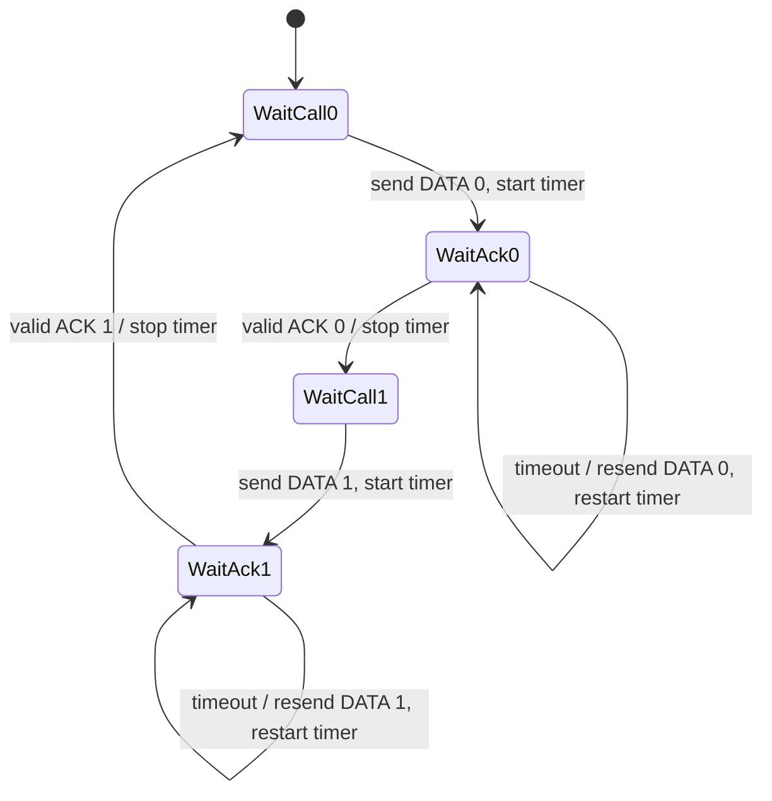
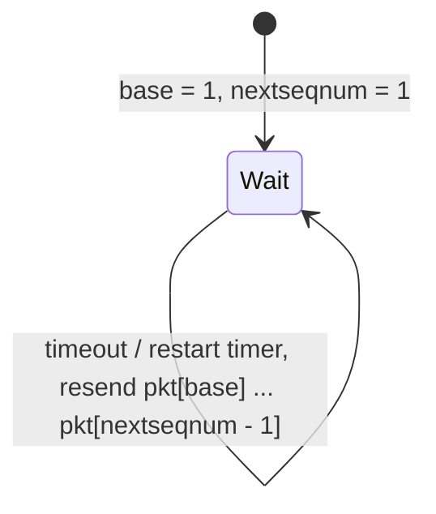
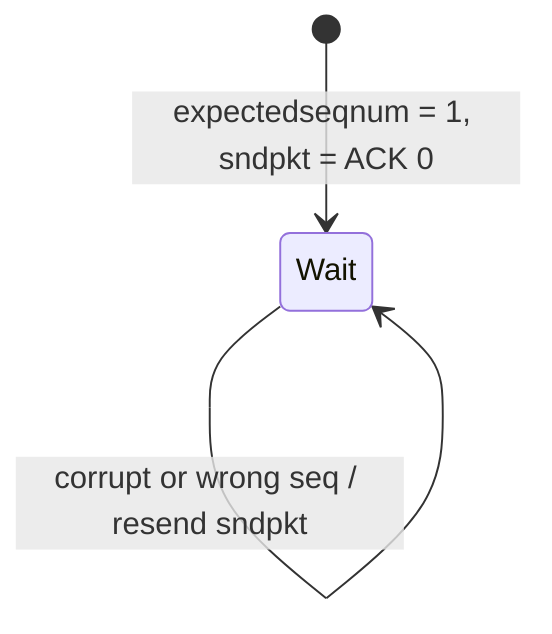

## Network Design Project - Phase Proposal and Design Document (Phase 4 of 5)
**Purpose:** hase 4 replaces stop-and-wait (RDT 3.0) with Go-Back-N (GBN). The sender can now have up to N packets in flight at once, which makes the transfer faster. 
**Names:** Maroua Boumkouk, Matthew Nguyen, Oluchukwu Okeke   
**GitHub Repo URL (with GitHub usernames):** https://github.com/MarouaBoumkouk/Network-Design-Phase-4 
**Phase:** 4
**Submission Date:** Sunday 15 November 2026  
**Version:** (1)

## 0) Executive Summary 
In Phase 3 we built RDT 3.0: one packet at a time, a countdown timer, and alternating 0/1 sequence numbers. It works, but the sender spends most of its time waiting for ACKs. In Phase 4 we add pipelining with Go-Back-N. The sender keeps a window of N packets, sequence numbers count up (1, 2, 3, ...), ACKs are cumulative, and on a timeout the sender resends every unACKed packet in the window. The receiver only accepts the next in-order packet and drops everything else.
 
We will test the same five scenarios:
1. No errors or loss
2. ACK bit-errors at the sender
3. DATA bit-errors at the receiver
4. ACK loss at the sender
5. DATA loss at the receiver
We will also demo each scenario with recovery ON and OFF.

## 1) Phase requirements
### 1.1 Demo deliverable
- **Private YouTube link:**: 


### 1.2 Required demo scenarios
| Option | Scenario | Where it happens | Expected result (recovery ON) |
|---|---|---|---|
| 1 | No errors/loss | - | File transfers with 0 resends |
| 2 | ACK bit-error | Sender, after receiving an ACK | Sender ignores the corrupt ACK; a later cumulative ACK or a timeout fixes it |
| 3 | DATA bit-error | Receiver, after receiving DATA | Receiver drops it, resends last ACK; sender times out and resends the window |
| 4 | ACK loss | Sender, after receiving an ACK | A later cumulative ACK covers it, or the sender times out and resends the window |
| 5 | DATA loss | Receiver, after receiving DATA | Later packets are out of order, so the receiver drops them and resends last ACK; sender times out and resends the window |
 
With recovery OFF, the received file will be missing parts or damaged for any rate above 0%.
For every option we check that the original and received files have the same SHA-256 hash.

### 1.3 Required figures / plots

- **Chart 1:** completion time vs. loss/error rate. 5 lines (Options 1-5), x = 0% to 95% in steps of 5%
- **Chart 2:** completion time vs. window size (1, 2, 5, 10, 20, 50) at 10% loss
- **Chart 3:** completion time for Phase 1, 2, 3, 4 with the same file and fixed loss / bit-error rates
- Each point is the average of 5 runs
- We will also find the best window size and timeout value

## 2) Phase plan 


### 2.1 Scope: what changes/additions this phase

- Sender window of size N (`--window`), with `base` and `nextseqnum`
- Sequence numbers count up (1, 2, 3, ...) instead of 0/1
- ACK Number field grows from 1 byte to 4 bytes (needed for counting-up ACKs)
- Cumulative ACKs: ACK n means all packets up to n arrived
- One timer for the oldest unACKed packet (`base`)
- On timeout, resend all packets from `base` to `nextseqnum - 1`
- Receiver keeps `expectedseqnum` and drops anything out of order
- `--no-recovery` flag for the demo
- New experiments and plots for Charts 1, 2, 3
**Not changing:**
- Packet types, checksum, and `maybe_corrupt()` / `maybe_drop()` in `corruption.py`
- Where errors are injected (right after `recvfrom()`)
- END retry cap and receiver linger from Phase 3
**Out of scope:**
- Selective Repeat (next phase)
- Adaptive timeout (like TCP's RTT estimate)
- Receiver buffering of out-of-order packets

     
### 2.2 Acceptance criteria 

- [ ] File transfers correctly in all 5 options (SHA-256 match)
- [ ] Sender sends up to N packets before waiting
- [ ] Cumulative ACK moves `base` forward correctly
- [ ] On timeout, sender resends the whole window (base to nextseqnum - 1)
- [ ] Receiver only delivers in-order packets and resends last ACK for anything else
- [ ] Works for N = 1, 2, 5, 10, 20, 50
- [ ] Recovery OFF gives a broken file when rate > 0
- [ ] Charts 1, 2, 3 made, each point = average of 5 runs

### 2.3 Work breakdown 

**Workstream A - Design, packet/corruption changes, README** (Maroua Boumkouk)
Design document, ACK Number field change in `packet.py`, `--no-recovery` flag, `test_rdt.py` update, README, final check.
 
**Workstream B - Sender and experiments** (Matthew Nguyen)
GBN sender (window, buffer, timer, go-back-N resend), test all 5 options with recovery ON/OFF, `run_experiments.py` and `plot_results.py` for Charts 1-3.
 
**Workstream C - Receiver and demo** (Oluchukwu Okeke)
GBN receiver (`expectedseqnum`, cumulative ACKs), collect Phase 1 and 2 code for Chart 3, demo video.
 


## 3) Architecture + state diagrams

## 3.1 How we Evolved the state diagram
In Phase 3 the sender had 4 states (wait for call 0/1, wait for ACK 0/1) because it only had one packet out at a time. In GBN the sender has one "Wait" state and keeps track of the window with `base` and `nextseqnum`. The receiver also goes down to one state, with an `expectedseqnum` counter instead of 0/1.
 
**Previous phase (Phase 3 - RDT 3.0 sender):**

 
**Current phase (Phase 4 - GBN sender):**

 
**Current phase (Phase 4 - GBN receiver):**

### 3.2 Component responsibilities

- **Sender (`sender.py`)**
  - Splits the file into 1024-byte chunks and makes all packets first (this is the buffer)
  - Sends up to N packets, runs one timer, resends the window on timeout
  - Checks ACKs (checksum, type) and moves `base` with cumulative ACKs
  - Option 2: corrupts received ACKs; Option 4: drops received ACKs
  - Measures completion time
- **Receiver (`receiver.py`)**
  - Checks DATA packets (checksum, sequence number == `expectedseqnum`)
  - Writes in-order data only, drops everything else, resends last ACK
  - Option 3: corrupts received DATA; Option 5: drops received DATA
  - Stays open for a short time after END in case its last ACK is lost
- **Shared modules**
  - Packet encode/decode + checksum: `packet.py`
  - Bit errors + loss: `corruption.py` (`maybe_corrupt()`, `maybe_drop()`)
  - Timing: `time.perf_counter()`
  - CLI: `argparse` (`--option`, `--error-rate`, `--window`, `--timeout`, `--no-recovery`, `--quiet`)

### 3.3 Message flow overview

The sender sends packets until the window is full and starts the timer for `base`. The receiver ACKs each in-order packet. Each valid ACK slides the window, and the sender fills the free spots with new packets. If a DATA packet is lost or corrupted, the receiver keeps sending the same ACK for the last good packet. No new ACK moves `base`, so the timer runs out and the sender goes back and resends every packet from `base`. A lost or corrupt ACK is usually harmless, because the next ACK is cumulative and covers it.
 
## 4) Packet format 
Same packet types and checksum as Phase 3. **One change:** the ACK Number field is now 4 bytes instead of 1. GBN sequence numbers count up past 255, so a 1-byte ACK number would wrap and break cumulative ACKs.

### 4.1 Packet types
| Type | Value | Description |
|---|---|---|
| DATA | 0 | File data |
| END | 1 | End of transfer |
| ACK | 2 | Acknowledgment |

### 4.2 Header fields 

| Field | Size | Description |
|---|---|---|
| Type | 1 byte | DATA, END, or ACK |
| Sequence Number | 4 bytes | 1, 2, 3, ... (counts up) |
| ACK Number | 4 byte | Last in-order seq received (cumulative changed from 1 byte) |
| Length | 2 bytes | Payload length |
| Checksum | 2 bytes | 16-bit Internet checksum over header + payload |
| Payload | Up to 1024 bytes | File data |
 
**Header format:** `>BIBHH` | **Header size:** 13 bytes
**Header Size:** 10 bytes

Sequence numbers start at 1 (like the textbook), so the receiver's starting ACK is ACK 0. ACK 0 sets `base = 1`, which changes nothing, so the sender just waits for the timeout.

## 5) Data structures + module map

### 5.1 Key data structures
| Structure | Purpose | Module |
|---|---|---|
| `packets[]` | All packets made from the file (send buffer) | `sender.py` |
| `base` | Oldest unACKed seq number | `sender.py` |
| `nextseqnum` | Next seq number to send | `sender.py` |
| `N` | Window size (`--window`, default 10) | `sender.py` |
| `deadline` | Time when the timer runs out | `sender.py` |
| `TIMEOUT` | Timer length (`--timeout`, default 50 ms) | `sender.py` |
| `MAX_END_RETRIES` | Cap on END resends | `sender.py` |
| `expectedseqnum` | Next in-order seq the receiver wants | `receiver.py` |
| `sndpkt` | Last ACK sent, resent for bad packets | `receiver.py` |
| `times[option][rate][run]` | Chart 1 raw times | `run_experiments.py` |
| `times_window[w][run]` | Chart 2 raw times | `run_experiments.py` |
| `times_phase[p][run]` | Chart 3 raw times | `run_experiments.py` |
   


### 5.2 Module map + dependencies
| Module | Responsibility |
|---|---|
| `src/sender.py` | GBN sender, window, timer, resends, Options 2 and 4 |
| `src/receiver.py` | GBN receiver, in-order check, ACKs, Options 3 and 5 |
| `src/packet.py` | Packet format and checksum |
| `src/corruption.py` | `maybe_corrupt()` and `maybe_drop()` |
| `scripts/test_rdt.py` | Tests for all 5 options and window sizes |
| `scripts/run_experiments.py` | Timing runs for Charts 1-3, saves CSV |
| `scripts/plot_results.py` | Makes Charts 1-3 |
   

## 6) Protocol logic (high-level spec before implementation)


### 6.1 Sender behavior

The sender fills the window, then waits. A valid ACK n moves `base` to n + 1. If that empties the window, the timer stops. If not, the timer restarts. A corrupt ACK is ignored. On timeout, the sender restarts the timer and resends every packet from `base` to `nextseqnum - 1`.
 
**Timer design:**
- Same deadline idea as Phase 3: `deadline = now + TIMEOUT`.
- `sock.settimeout(deadline - now)` so the socket only waits until the deadline.
- `socket.timeout` = timer expired → resend the window and set a new deadline.
- The timer is only restarted by an ACK that moves `base`. A corrupt or old ACK does **not** reset it.
- `TIMEOUT` is about 50 ms. The RTT on localhost is much smaller, so we don't get early timeouts.
**Sender pseudocode:**
```text
packets = [None] + make all DATA packets (seq 1..n) + END packet (seq n+1)
base = 1; nextseqnum = 1
while base <= last_seq:
    while nextseqnum < base + N and nextseqnum <= last_seq:
        send(packets[nextseqnum])
        if base == nextseqnum: deadline = now + TIMEOUT
        nextseqnum += 1
    wait for a packet until deadline
    if timeout:
        if base == last_seq and end_retries >= MAX_END_RETRIES: break
        deadline = now + TIMEOUT
        for i in base .. nextseqnum - 1: send(packets[i])
        continue
    if option 4 and maybe_drop(rate): continue          # ACK lost
    if option 2: rcvpkt = maybe_corrupt(rcvpkt, rate)    # ACK bit-error
    if is_corrupt(rcvpkt) or type != ACK: continue       # do nothing
    if ack >= base:                                      # cumulative ACK
        base = ack + 1
        if base == nextseqnum: stop timer
        else: deadline = now + TIMEOUT
```
 

### 6.2 Receiver behavior
The receiver only accepts the packet it expects next. If it is valid and in order, it writes the data, ACKs that seq number, and moves `expectedseqnum` up by 1. Anything else (corrupt, out of order, or duplicate) is dropped, and the receiver resends its last ACK. It never buffers out-of-order packets.
 
**Receiver pseudocode:**
```text
expectedseqnum = 1
sndpkt = make_ack(0)
loop:
    rcvpkt = receive()
    if option 5 and maybe_drop(rate): continue          # DATA lost
    if option 3: rcvpkt = maybe_corrupt(rcvpkt, rate)    # DATA bit-error
    if is_corrupt(rcvpkt) or seq != expectedseqnum:
        send(sndpkt)                                     # resend last ACK
        continue
    if END: done = True else: write(payload)
    sndpkt = make_ack(expectedseqnum); send(sndpkt)
    expectedseqnum += 1
    if done: keep answering for LINGER seconds, then stop
```
 
### 6.3 Error/loss injection spec (if required by phase)
No change from Phase 3. Both functions live in `corruption.py` and use the rate from `--error-rate` (0 to 1).
 
| Function | What it does | Used by |
|---|---|---|
| `maybe_corrupt(pkt, rate)` | With chance `rate`, flips one random bit | Option 2 (sender, ACKs), Option 3 (receiver, DATA) |
| `maybe_drop(rate)` | Returns True with chance `rate` | Option 4 (sender, ACKs), Option 5 (receiver, DATA) |
 
- Injection happens right after `recvfrom()`, on the receive path, like the spec says.
- A dropped packet is skipped with `continue`, as if it never arrived.
### 6.4 Recovery ON / OFF
`--no-recovery` is passed to both the sender and the receiver.
 
| | Recovery ON (default) | Recovery OFF |
|---|---|---|
| Sender | Full GBN (window, timer, resend) | Sends every packet once, then END. No timer, no resend |
| Receiver | Checksum + in-order check | Writes every DATA packet it gets, even corrupt or out of order |
| Result | SHA-256 matches | File is missing parts or damaged when rate > 0 |
 

## 7) Experiments + metrics plan (required if phase requires figures/plots)
## 7.1 Measurement definition
- **Start:** right before the sender sends the first packet
- **Stop:** when the sender gets the valid ACK for END (or hits the END retry cap)
- **Tool:** `time.perf_counter()`
- **File:** `data/tiny.bmp` for all charts, payload size 1024 bytes
- Printing is turned off (`--quiet`) during timing runs
- Each run is checked with SHA-256
- Each run has a time cap so the 90-95% runs can't hang forever
| Chart | Settings | Runs |
|---|---|---|
| 1 | Options 1-5, rates = [0, 5, 10, ..., 95], N = 10, 5 runs each | 500 |
| 2 | Option 5 at 10% loss, N = [1, 2, 5, 10, 20, 50], 5 runs each | 30 |
| 3 | Phases 1-4, same file, 10% DATA loss (Option 5) and 10% DATA bit-error (Option 3), 5 runs each | 40 |
| Timeout test | Option 5 at 10% loss, N = 10, TIMEOUT = [10, 25, 50, 100, 200] ms, 5 runs each | 25 |
 
Chart 3 notes: Phase 1 has no recovery, so it finishes fast but the file is broken. Phase 2 (RDT 2.2) has no timer, so it can't recover from loss; we only time it for bit-errors and mark loss as "does not finish".
 

### 7.2 Output artifacts

- Time goes up as the rate goes up, and very fast near 90-95%.
- DATA loss/errors (Options 3, 5) should be slower than ACK loss/errors (Options 2, 4). A lost ACK is often covered by the next cumulative ACK, but a lost DATA packet forces a full go-back.
- Small N is slow (N = 1 is stop-and-wait). Very large N resends a lot after each loss. We expect the best N to be in the middle.
- A very small timeout causes extra resends, and a very large one wastes time waiting. We expect the best timeout to be a little above the RTT.
- Phase 4 should be the fastest reliable phase because of pipelining.

### 7.3 Output artifacts
- `results/raw_times.csv` - chart, option/phase, rate, window, run, time
- `results/avg_times.csv` - averages for every point
- `results/chart1_options.png` - 5 lines on one chart
- `results/chart2_window.png` - time vs. window size
- `results/chart3_phases.png` - Phase 1-4 comparison

## 8) Edge cases + test plan

### 8.1 Edge cases you expect

| Edge case | Expected behavior |
|---|---|
| DATA lost in the middle of the window | Receiver drops later packets and resends last ACK; sender times out and resends from `base` |
| ACK lost | Next cumulative ACK covers it; if it was the last one, sender times out and resends |
| Corrupt ACK | Ignored; does not reset the timer |
| Duplicate DATA (after a go-back) | Not written again; receiver resends last ACK |
| First packet lost/corrupt | Receiver sends ACK 0; sender ignores it and resends on timeout |
| Old ACK (ack < base) | Ignored |
| Last ACK (for END) lost | Receiver is still lingering and re-ACKs; sender caps END retries |
| N = 1 | Works like stop-and-wait |
| N bigger than the number of packets | Sender sends the whole file at once, still works |
| Small last chunk | Correct length is written |
| Very high rate (95%) | Many timeouts, but the file still arrives correctly (or hits the time cap) |
 


### 8.2 Tests you will write because of these edge cases

**Unit tests:**
- Packet round trip with the new 13-byte header (make → extract)
- Every single-bit flip is caught by the checksum
- Seq and ACK numbers above 255 work
- `maybe_drop(0)` never drops, `maybe_drop(1)` always drops
**Integration tests:**
- Option 1 at 0%
- Options 2-5 at 30% and 50%
- N = 1, 2, 5, 10, 20, 50 at 10%
- Recovery OFF at 30% → SHA-256 should NOT match
- SHA-256 match for every recovery ON run


### 8.3 Test artifacts
- **Input:** `data/small.bmp`, `data/tiny.bmp`
- **Output:** `results/received.bmp`
- **Results:** CSVs and 3 charts in `results/`
- **Evidence:** test output, file hashes, charts


   
## 9) Repo Structure + Reproducibility

 
```text
Network-Design-Phase-4/
├── src/
│   ├── sender.py
│   ├── receiver.py
│   ├── packet.py
│   └── corruption.py
├── scripts/
│   ├── test_rdt.py
│   ├── run_experiments.py
│   └── plot_results.py
├── phases/              # Phase 1 and 2 code for Chart 3
├── docs/
│   └── DESIGN_DOCUMENT.md
├── data/
│   ├── small.bmp
│   └── tiny.bmp
├── results/
└── README.md
```
 
**Run one option** (from `src/`, receiver first):
```bash
python receiver.py --option 5 --error-rate 0.2
python sender.py --option 5 --error-rate 0.2 --window 10
```
 
**Recovery OFF demo:**
```bash
python receiver.py --option 5 --error-rate 0.2 --no-recovery
python sender.py --option 5 --error-rate 0.2 --no-recovery
```
 
**Tests, experiments, and plots** (from the repo root):
```bash
python scripts/test_rdt.py
python scripts/run_experiments.py --file data/tiny.bmp
python scripts/plot_results.py
```
 

## 10) Team plan, ownership, and milestones
### 10.1 Task ownership
| Task | Owner | Definition of done |
|---|---|---|
| Design document | Maroua | Pushed to `docs/` before coding starts |
| ACK Number field change (`packet.py`) | Maroua | Unit tests pass with seq/ACK > 255 |
| `--no-recovery` flag | Maroua | Recovery OFF gives a broken file at 30% |
| `test_rdt.py` update | Maroua | All tests pass |
| GBN sender | Matthew | Options 1-5 pass with N = 1 and N = 10 |
| Test all 5 options (recovery ON/OFF) | Matthew | Results shared with team |
| Experiment + plot scripts, run experiments | Matthew | CSVs + 3 charts in `results/` |
| GBN receiver | Oluchi | Out-of-order packets dropped, last ACK resent |
| Phase 1 + 2 code for Chart 3 | Oluchi | Runs on `tiny.bmp` from `phases/` |
| Demo video | Oluchi | Link in README |
| README | Maroua | All options, window size, and plots documented |
| Final check + instructor access | Maroua | Rubric checked, instructor can see repo |

### 10.2 Milestones 

1. **Design done** - this document pushed
2. **Code done** - GBN sender and receiver, all 5 options working
3. **Tested** - `test_rdt.py` passes for all 5 options and all window sizes
4. **Experiments done** - 3 charts and CSVs in `results/`
5. **Submit** - README, video, contribution files, final check
 

