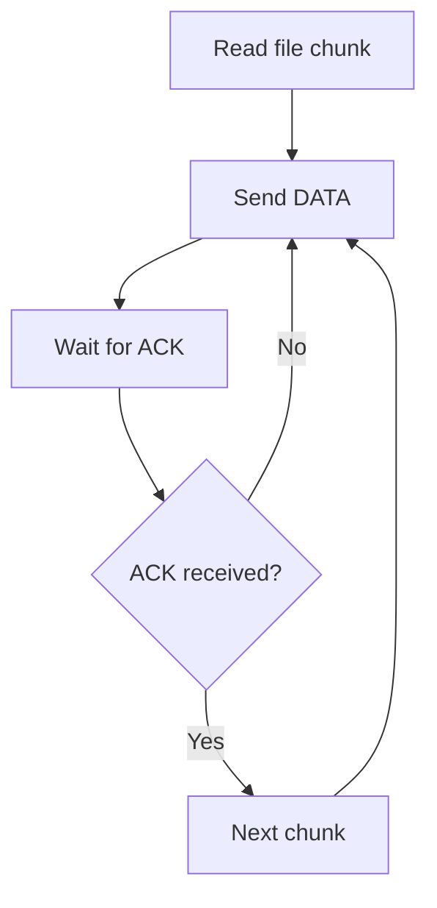
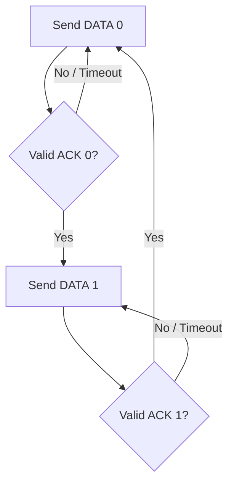
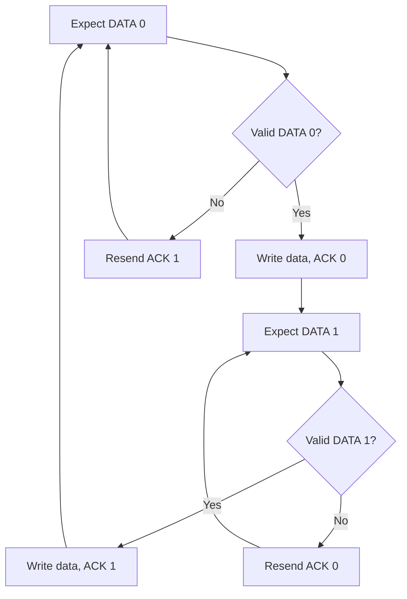

## Network Design Project - Phase Proposal and Design Document (Phase 2 of 5)
**Purpose:**  
**Names:** Maroua Boumkouk Matthew Nguyen   
**GitHub Repo URL (with GitHub usernames):**  https://github.com/MattN11/Network-Design-Phase-2  
**Phase:** 2  
**Submission Date:** Friday 09 October 2026  
**Version:** (1)

## 0) Executive Summary 
   For Phase 2, our team will build off of our previous UDP transfer file project but implementing the Reliable Data Transfer 2.2 Protocol. This phase will focus on detecting corrupted packets, acknowledgements, and recover through retransmission. Our implementation uses alternating sequence numbers, checksums, and acknowledgement to make sure the file is transferred correctly. 

We will test three scenarios:
1. File transfer with no errors
2. ACK bit corruption at the sender.
3. DATA bit corruption at the receiver

## 1) Phase requirements
### 1.1 Demo deliverable
- **Private YouTube link:**  

### 1.2 Required demo scenarios
| Option | Scenario | Expected Result|
|---|---|---|
| 1 | No Errors | File tansfers succesfully |
| 2 | ACK bit corruption | Sender detects corrupted ACKs and retransmits DATA packets |
| 3 | DATA bit corruption | Receiver detects corrupted DATA packets and resends its previous ACK |

We will also verify that the original and receive file have matching SHA-256 hashes.

### 1.3 Required figures / plots

We will generate performance graphs showing how packet corruption affects file transfer time.

Phase 2 will use:
- Corruption rates from **0% to 95%**
- Increments of **5%**
- **5 trials** per corruption rate
- Average transfer time for each corruption rate
  

## 2) Phase plan (company-style, lightweight)

### 2.1 Scope: what changes/additions this phase

For phase 2, our team will improve our previous UDP file transfer project by implementing the RDT 2.2 protocol

The following features will be added:
- Alternating sequence numbers
- Checksum generation and verification
- Detection of corrupted DATA and ACK packets
- Retransmission when ACK is corrupted or incorrect
- Detection of duplicate packets
- ACK generation and validation
- Simulation of DATA and ACK bit Corruption

  **Out of Scope:**
  - Simulating packet loss as a separate test scenario
  - Sliding window protocols
  - Transferring multiple files simultaneously
     
### 2.2 Acceptance criteria (your checklist)
List 5–10 measurable checks that mean you’re done (examples below).

- [ ] The sender successfully transfers BMP file using UDP 
- [ ] The receiver reconstructs the original file correctly
- [ ] Sequence numbers alternate between 1 and 0
- [ ] Checksums detect corrupted DATA and ACK packets 
- [ ] The sender Retransmits packets when ACK is corrupted  
- [ ] The receiver detects duplicate packets 

### 2.3 Work breakdown (high-level; Person X will work on A, Person Y will work on B...)
Workstream A - Packet Structure and Checksums 
Member will work on packet creation, extraction, and checksum verification  

Workstream B - Sender Implementation 
Member will implement sender sequence numbers, ACK processing, retransmission, and ACK corruption 

Workstream C - Receiver Implementation
Member will implement receiver validation, duplicate evaluation, ACK generation, and Data corruption. 

## 3) Architecture + state diagrams
Your phase specs likely include a reference state diagram. **You should build on it across phases.**

## 3.1 How we Evolved the state diagram
For phase 2, our team is building on the UDP file transfer system developed in Phase 1. 

In phase 1, the sender transmitted packets and waited for acknowledgements before continuing. In phase 2, we added checksum verification, alternating sequence numbers, and retransmission to handle corrupted packets.  

**Current Phase (Phase 2 - Sender):**

**Current Phase (Phase 2 - Receiver):**

### 3.2 Component responsibilities
- **Sender(sender.py)**
  responsibilities:
  - Reads and sends file chunks
  - Tracks sequence numbers and validated ACKs
  - Retransmits packets when needed
  - Simulates ACK corruption
    
    
- **Receiver**
  Responsibilities:
  - Receives and verifies DATA packets
  - Detects duplicates and writes valid data
  - Sends ACKs and handles DATA corruption
  - Processes the END packet
     
- **Shared modules/utilities**
  - packet encode/decode: `packet.py`
  - Checksum: `packet.py`
  - Error injection: `corruption.py`
  - Logging/timing: Console output and `time.perf_counter()`
  - CLI parsing: `argpars`

### 3.3 Message flow overview

The sender sends DATA packets over UDP, and the receiver responds with ACKs. Corrupted packets trigger retransmissions.

## 4) Packet format 

### 4.1 Packet types
Our protocol uses three packet types: 

| Type | Value | Description |  
|---|---|---|
| DATA | 0 | Contains file data | 
| END | 1 | Signals the end of the transfer|
| ACK | 2 | Confirms packet reception | 

### 4.2 Header fields 

| Field | Size | Description |
|---|---|---|
| Type | 1 byte | Identifies DATA, ACK, or END |
| Sequence Number | 4 bytes | Alternates between 0 and 1 |
| ACK Number | 1 byte | Identifies the acknowledged packet |
| Length | 2 bytes | Number of payload bytes |
| Checksum | 2 bytes | Detects packet corruption |
| Payload | Up to 1024 bytes | File data |

**Header Format:** `>BIBHH`

**Header Size:** 10 bytes

## 5) Data structures + module map

### 5.1 Key data structures

### 5.2 Module map + dependencies

## 6) Protocol logic (high-level spec before implementation)
This section is your “engineering spec” that you implement against. Keep it precise but not code-heavy.

### 6.1 Sender behavior
The sender uses a stop and wait protocol. It sends one DATA packet and waits for a valid ACK before sending the next packet.
If the ACK is corrupted, incorrect, or times out, the sender retransmits the same packet. 

**Sender pseudocode (recommended):**

### 6.2 Receiver behavior
The receiver checks incoming DATA packets using checksums and sequence numbers.  
Valid packets are written to the output file. corrupted or duplicate Packets are not written. and the receiver resends its previous ACK.m 

**Receiver pseudocode (recommended):**

### 6.3 Error/loss injection spec (if required by phase)
Our project uses `corruption.py` to simulate bit errors.

- **Option 1:** No corruption
- **Option 2:** ACK corruption at the sender after receiving an ACK
- **Option 3:** DATA corruption occurs at the receiver after receiving a DATA packet
  

## 7) Experiments + metrics plan (required if phase requires figures/plots)
 

### 7.2 Output artifacts

## 8) Edge cases + test plan

### 8.1 Edge cases you expect

| Edge case | Why it matters | Expected behavior |

### 8.2 Tests you will write because of these edge cases

### 8.3 Test artifacts

## 9) Repo structure + reproducibility

## 10) Team plan, ownership, and milestones
### 10.1 Task ownership
| Task | Owner | Target date | Definition of done |

### 10.2 Milestones (keep it realistic)

